# Equation Shift

Manual de instruções do jogo

Você é a **Interrogação**, num mundo habitado por sinais. Quando o Erro foge para as Ruínas da Matemática e a vila começa a tremer, você vai atrás dele. Para abrir caminho, empurre números e operadores, complete igualdades e use o próprio personagem como um dos símbolos da conta.

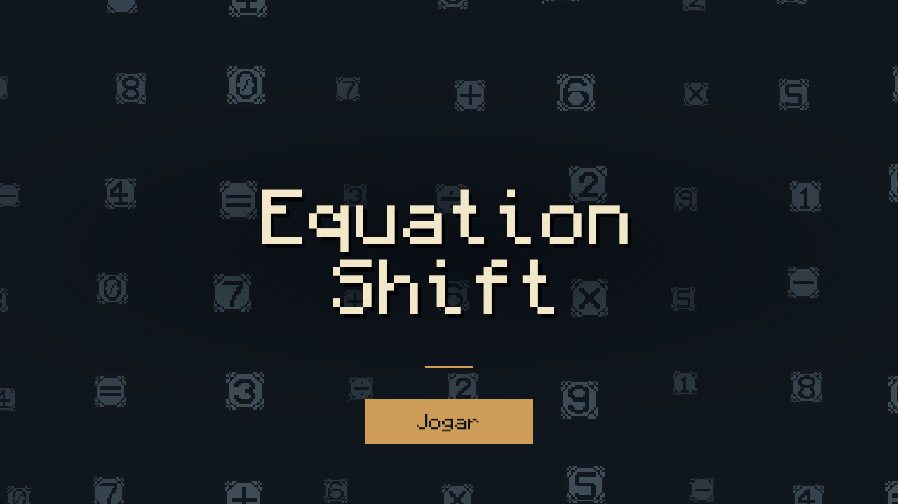

**Tela de título.** Clique em **Jogar** para começar.

| Vila dos Sinais | Entrada das Ruínas da Matemática |
| --- | --- |
| 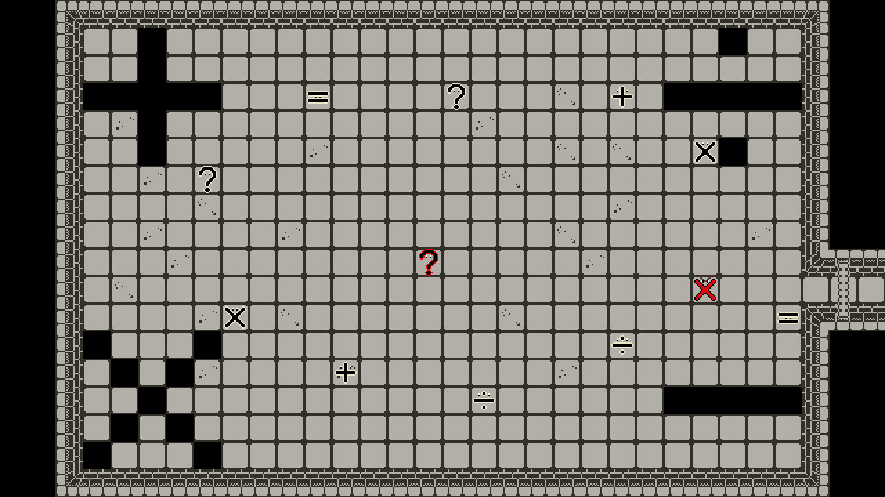 | 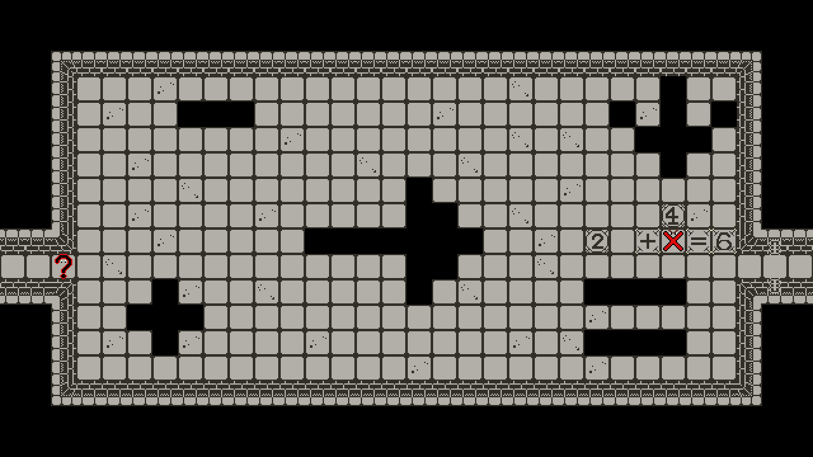 |

## A fuga da Vila dos Sinais

Na vila, os moradores falam sobre o papel de cada símbolo. Um deles compara o sinal de igual a uma balança com o mesmo valor dos dois lados. Perto do portão à direita, o guarda conta que as funções que regem o mundo estão nas Ruínas da Matemática. Já o Erro, o **X vermelho**, está entediado e quer fazer algo diferente para se divertir.

Pare ao lado de **cinco moradores diferentes, incluindo o Erro**, para ouvir suas falas. Quando a última conversa terminar, o Erro abre o portão e foge. A vila treme logo depois. Se você falar de novo com o guarda, ele pede que alguém vá às ruínas investigar o que aconteceu com as funções.

| Antes da fuga | Depois do tremor |
| --- | --- |
| 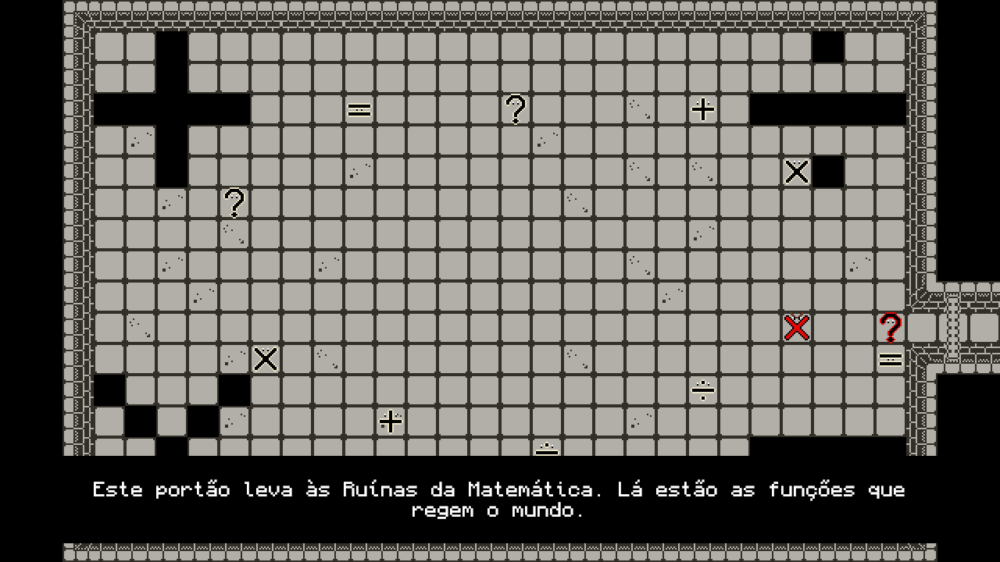 | 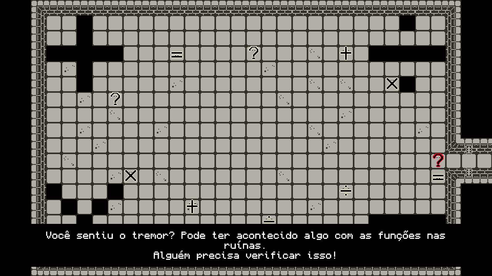 |

## Comandos e peças

| Comando | Ação |
| --- | --- |
| `W` ou `↑` | Andar para cima |
| `A` ou `←` | Andar para a esquerda |
| `S` ou `↓` | Andar para baixo |
| `D` ou `→` | Andar para a direita |
| `Tab` | Alternar entre a Interrogação e as formas coletadas |
| `R` | Restaurar os blocos e voltar ao início ou à entrada da sala |

Para **empurrar**, ande na direção do bloco móvel. A célula para onde ele vai precisa estar livre. Para **conversar** ou **acionar uma alavanca**, pare numa das quatro células vizinhas. Para **coletar** uma transformação, pise na célula do item.

| Sprite do jogo | Elemento | Como usar ou reconhecer |
| --- | --- | --- |
| 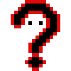 | **Interrogação** | O personagem que você controla. |
| 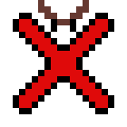 | **Erro** | O X vermelho que foge da vila e mexe nas equações. |
| 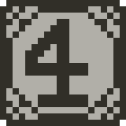 | **Bloco móvel** | Número ou operador que pode ser empurrado. |
| 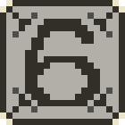 | **Âncora** | Bloco fixo que precisa entrar na conta do portão ao qual está ligado. |
| 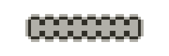 | **Portão** | Passagem que se abre ao cumprir a condição da sala. |
| 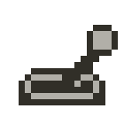 | **Alavanca** | Mecanismo que você aciona ao parar ao lado dele. |

## A primeira conta nas ruínas

### O reencontro com o Erro

Ao entrar nas ruínas, você sente outro tremor. O Erro acha graça e diz que quer mexer mais por ali. Ele sai pela direita e fecha o portão atrás de si. Quando você recuperar o controle, monte a primeira conta para abrir a mesma passagem.

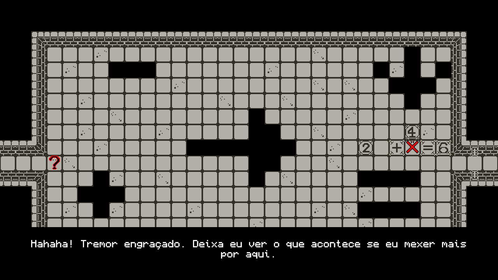

### Como abrir o portão

Alinhe os símbolos sem deixar espaços, com um único `=`. Leia da esquerda para a direita ou de cima para baixo. Dígitos lado a lado formam números como `12`. Multiplicação e divisão vêm antes de soma e subtração. Para abrir um portão de equação, os dois lados da conta precisam valer o mesmo e a âncora da passagem precisa fazer parte dela.

Nesta sala, empurre o `2` uma casa para a direita, até encostar no `+`. Passe por cima do `4` e empurre-o uma casa para baixo, entre o `+` e o `=`. A conta **`2 + 4 = 6`** inclui o `6` fixo, que é a âncora. Espere o portão abrir e siga pelo corredor. Se uma peça ficar presa, pressione **R** para recomeçar a montagem.

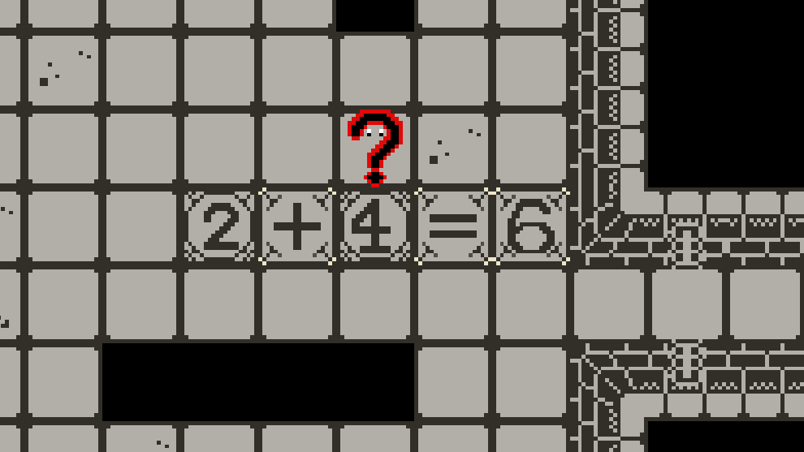

## Como usar as transformações

**Pise no coletável que tem o símbolo da forma.** O item se aproxima da Interrogação e desaparece. O personagem assume a nova forma e aparece a dica **“Use Tab para trocar de forma.”** Você leva as formas coletadas ao mudar de sala ou voltar pelo mesmo caminho.

Quando faltar um sinal numa conta, pressione **Tab** até escolher a forma certa e pare na célula vazia. A primeira forma que você encontra é **Igual**. Fique entre dois blocos `9` para montar `9 = 9`. O sinal vermelho entre os números é o próprio personagem.

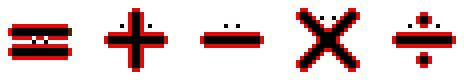

| Forma | Primeira conta com a forma |
| --- | --- |
| **Igual** `=` | `9 = 9` |
| **Mais** `+` | `3 + 5 = 8` |
| **Menos** `−` | `7 − 3 = 4` |
| **Vezes** `×` | `2 × 5 = 10` |
| **Divisão** `÷` | `9 ÷ 3 = 3` |

| Antes da coleta | Igual em uso |
| --- | --- |
| 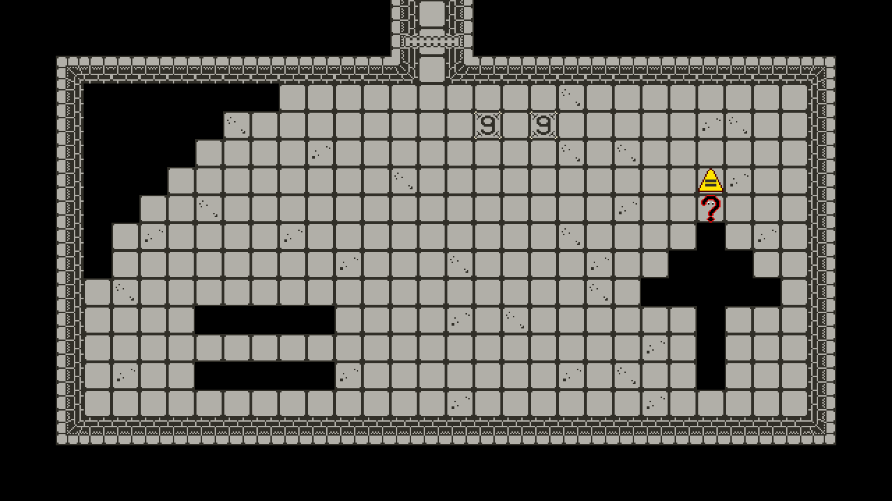 | 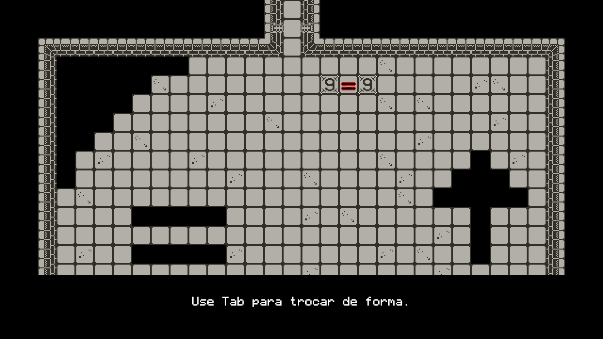 |
| Pise na célula do item amarelo. | Complete a conta entre os dois `9`. |

## Volte com o sinal que faltava

Alguns portões só abrem quando a Interrogação entra na conta com uma forma específica. Se você ainda não tem o símbolo, procure outra saída. Na sala do coletável, uma conta curta ajuda você a praticar a nova forma.

### O desvio para buscar Igual

1. Na sala depois da primeira conta, o portão à direita pede **Igual**. Monte `7 − 4 = 3` para abrir a saída de baixo e descer até o coletável amarelo.
2. Pegue a forma e fique entre os dois `9` para completar `9 = 9`. O portão de cima se abre para você voltar à sala anterior.
3. De volta à sala, alinhe o `3` e fique entre ele e o `5` na forma Igual. Assim, **`2 + 3 = 5`** abre a saída da direita.

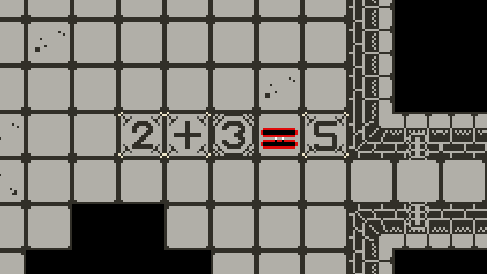

### Mais adiante nas ruínas

- **Mais e Menos.** Quando a saída da direita pedir `+`, explore o caminho pelo topo até encontrar a forma Mais. Volte para abrir a passagem da direita e pegue Menos na sala seguinte. Depois de praticar `−` na saída dessa sala, retorne à sala logo abaixo de onde você coletou Mais. Use Menos para abrir a passagem à esquerda.
- **Vezes.** Quando chegar à sala que tem o portão final no topo, saia pela direita para buscar `×`. Use a forma para resolver `2 × 5 = 10` e seguir à direita. Mais adiante, Vezes libera o portão de baixo que leva ao desvio da Divisão.
- **Divisão.** Depois de usar Vezes para descer a uma nova sala, você encontra um portão à esquerda que pede `÷`. Desça mais uma sala para coletar Divisão. Complete `9 ÷ 3 = 3` para voltar e use a forma no portão da esquerda. Uma das alavancas fica depois dessa passagem.

## As alavancas e o desfecho

### Duas alavancas para a mesma passagem

A entrada da sala final fica num portão no topo, que só abre depois de acionar **duas alavancas**. Você chega a uma pelo caminho da Divisão. Para a outra, volte à sala que dá acesso ao final e saia à esquerda. Use Divisão para seguir mais à esquerda e Vezes para abrir a passagem de baixo. Pare ao lado de cada alavanca para acioná-la. Com as duas ativas, volte ao portão do topo.

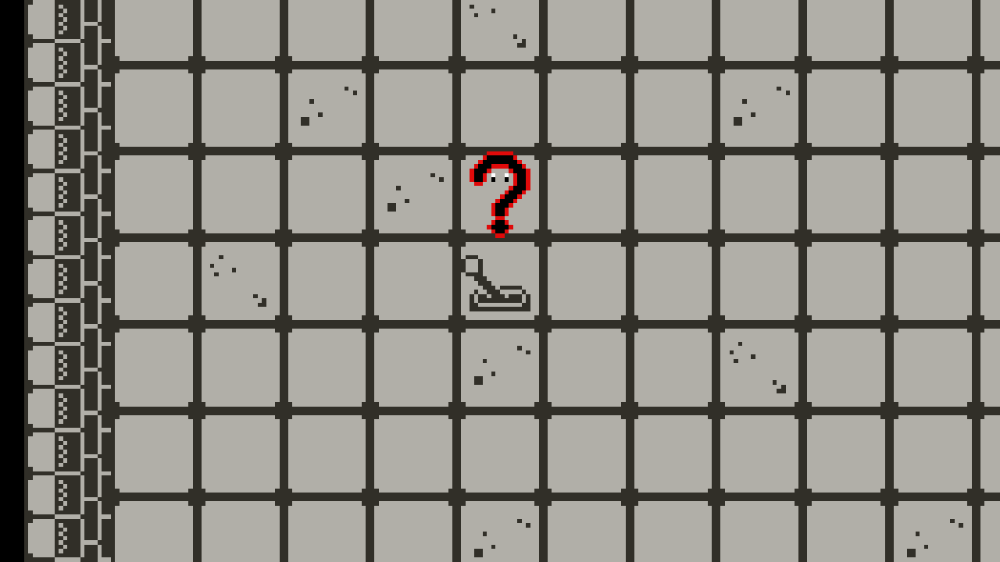

### A função principal

Na sala final, o Erro admite que mexeu nas equações. Na fuga, ele empurra a Interrogação para o lado e fecha o portão. A sala treme mais uma vez.

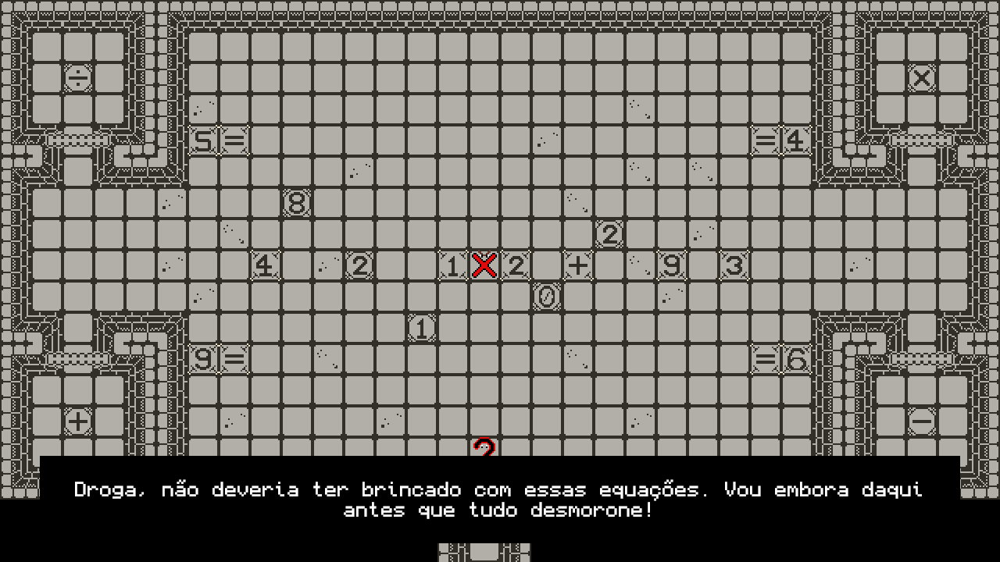

Resolva as quatro contas menores para liberar peças. A conta principal precisa reunir **as duas âncoras do portão final na mesma igualdade**. Se você resolver uma conta com só uma delas, a Interrogação dá uma dica para usar todos os blocos móveis. Quando o portão abre, ela diz que finalmente encontrou seu propósito. A tela escurece e aparece **Fim de Jogo**. **Jogar Novamente** volta ao título.

O percurso completo e a tabela de soluções estão no [Guia de Fases](Guia%20de%20Fases.md).
